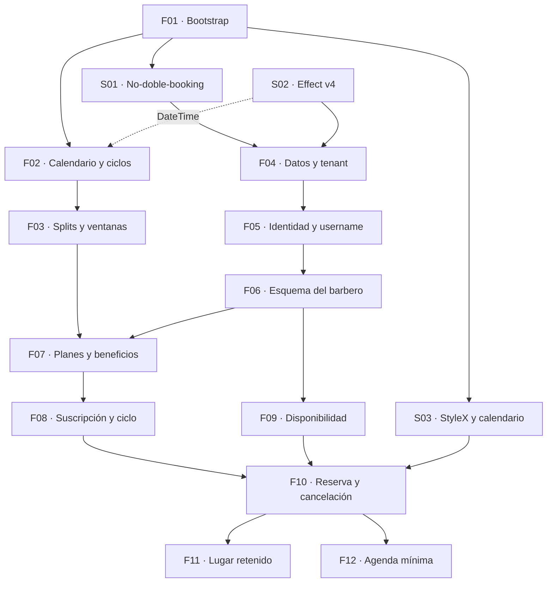

# Backlog

Cada entrada es **una feature del tamaño de un grilling**: un pedazo coherente con un resultado visible, cuyo spec después se abre en 2 a 6 tickets. No están pre-partidas a propósito — partirlas es trabajo del spec.

Flujo por entrada: **grilling → spec → tickets → implementación.**

> La skill `mattpocock-skills:grilling` está disponible en esta sesión. Trabaja como árbol de decisiones en rondas, así que cada entrada de acá abajo trae sus **decisiones raíz** en *Qué grillear*: son el material de la primera ronda, no una lista de tareas.

---

## El hilo mínimo

Todo lo marcado **MVP** existe para sostener una sola secuencia:

```
el barbero arma su esquema → crea un plan → se lo activa a un cliente
      → el cliente reserva con su crédito → el barbero ve su agenda
```

Si algo no está en ese hilo, no es MVP. El resto está ordenado abajo con su etiqueta.

**Lo que NO entra en el MVP, y está decidido:** la reserva sin cuenta. El piloto acordado es *solo suscriptores; el resto sigue en el sistema actual del barbero* (`propuesta-barbero.md`, Variante H).

---

## Qué bloquea qué



**F01 es lo único que no depende de nada, y desbloquea todo.** Después de eso se abren tres caminos en paralelo: los spikes S01 y S03, y el dominio puro.

**El dominio puro casi no depende de nada.** F02 y F03 solo necesitan el bootstrap y la verificación de `DateTime` (S02). Son la mitad del valor del proyecto, se testean sin base de datos, y se pueden escribir mientras los spikes corren. **Empezá por ahí apenas F01 esté listo.**

**S02 se puede correr desde el día uno**, en paralelo con F01: solo necesita leer los docs de la v4 y compilar un ejemplo.

---

# Spikes

No son features. Son verificaciones timeboxeadas que cierran los ítems abiertos de `CLAUDE.md`. **Su entregable es un ADR actualizado**, no código de producción. Si alguna responde que no, cambia el diseño — por eso van primero.

### S01 — La garantía de no-doble-booking

**Depende de F01** (necesita el proyecto y la conexión ya configurados).

**El driver ya está decidido: `node-postgres` sobre el endpoint pooleado de Neon.** `neon-http` no tiene soporte suficiente para lo que necesitamos. Así que esto deja de ser una exploración y pasa a ser una confirmación de que la garantía funciona.

Verificar, contra una base Neon real:

- Que **`db.transaction()` de Drizzle sobre `node-postgres`** dé transacciones interactivas reales, y que un rollback deshaga de verdad. Es lo que sostiene "si el insert falla, el crédito no se quema".
- Que Neon exponga **`btree_gist`**.
- Si **Drizzle Kit** puede expresar `EXCLUDE`, o va como migración SQL cruda.
- Que un `EXCLUDE USING gist` con rangos semiabiertos rechace solapamientos y **acepte turnos pegados**.
- **Cómo llega la violación del constraint al código.** Hay que distinguir "este horario se ocupó" de cualquier otro error de base, y eso se hace por el código de error de Postgres, no por el texto del mensaje.
- Si el pooling en modo transaction se lleva bien con los **prepared statements** de Drizzle, o hay que desactivarlos.

**Se considera hecho cuando** hay un test que corre dos inserts solapados en paralelo contra Postgres real y exactamente uno falla, el código distingue esa violación de otros errores, y los ADR 0001 y 0003 quedan actualizados con lo encontrado.

**Bloquea:** F04, F10.

---

### S02 — Effect v4 RC: superficie y borde con el dominio

Verificar contra los docs de la v4 RC:

- Cómo se llaman y se comportan los **módulos de datos puros** en v4 (la v4 reorganizó esa parte).
- Si el **tipo resultado del dominio se puede *yield*ear** directo adentro de un `Effect.gen`. Si sí, el borde dominio ↔ casos de uso sale gratis; si no, hay que diseñar la conversión.
- El soporte de **fecha de calendario** de `DateTime`. Si no alcanza para representar "el sábado de la barbería" sin arrastrar un instante, se cae a Temporal (ADR 0006).
- La integración **Drizzle ↔ Effect** para la versión elegida.

**Se considera hecho cuando** hay un ejemplo mínimo compilando con la versión pineada, los idioms elegidos están escritos en `CLAUDE.md` con ejemplos reales, y los ADR 0004 y 0006 quedan actualizados.

**Bloquea:** F04 y todos los casos de uso. Parcialmente F02, solo por `DateTime`.

---

### S03 — StyleX y primitivas de calendario

Verificar:

- El estado del **plugin de StyleX con App Router y Turbopack**.
- Cuál de **Radix, Base UI o React Aria** trae headless de **calendario y campo de fecha**. Define si el panel del barbero lleva días o semanas.

**Se considera hecho cuando** hay una página de ejemplo con un date picker headless estilado con StyleX, corriendo en dev y en build, y el ADR 0008 queda actualizado con la librería elegida.

**Bloquea:** toda la UI.

---

# MVP

### F01 — Bootstrap: esqueleto que camina

**MVP** · depende de: nada

**No es una app vacía: es un esqueleto que camina de punta a punta.** Toda la tecnología instalada, configurada y conectada, con lo mínimo que prueba que cada pieza funciona junta. Sin nada de negocio.

| Pieza | Qué queda funcionando |
|---|---|
| Next.js App Router + TypeScript estricto | Corre en dev y buildea |
| **Postgres en Neon + Drizzle** | Conexión con **`node-postgres` sobre el endpoint pooleado**, una tabla de prueba, una migración aplicada con Drizzle Kit |
| **better-auth** | Login con Google y con email, funcionando. Sin username ni roles todavía — eso es F05 |
| StyleX | Un componente estilado, en dev y en build |
| Vitest | Un test unitario corriendo |
| Playwright | Un e2e que entra con un usuario y ve una página privada |
| ESLint + Prettier | Configurados y corriendo en CI |
| CI | Tipos, lint, formato y tests, bloqueando el merge |
| Estructura de carpetas | `domain/`, `features/`, `app/` de ADR 0009, creadas |

**Qué grillear**
- ¿La regla de dependencias se *enforcea* con herramienta (lint de boundaries) o queda como convención en `CLAUDE.md`? Una regla que no falla el build no es una regla.
- **Tamaño del pool con `node-postgres` en serverless.** Cada instancia de Vercel levanta su propio pool. Contra el endpoint pooleado de Neon eso se tolera, pero el `max` tiene que ser chico (1 o 2), no el default.
- ¿Qué corre en CI y qué bloquea el merge? ¿Los tests de integración también, o solo local?
- ¿Cómo se provisiona la base para CI y para los tests de integración? Branch de Neon por PR, o Postgres en Docker.
- ¿Monorepo o app única? Importa si React Native entra después.
- ¿Prettier solo, o Prettier + reglas de formato en ESLint? Conviene que no se peleen.

**Se considera hecho cuando** `pnpm dev`, `pnpm test`, `pnpm e2e` y `pnpm build` corren limpios en CI; un usuario puede loguearse con Google y con email; una página lee un dato de Postgres; y un import que viole la regla de dependencias falla el build.

**Fuera de alcance:** cualquier tabla de negocio, el username, los roles, el `EXCLUDE`. Eso es F04, F05 y S01.

---

### F02 — Motor de calendario y ciclos

**MVP** · depende de: F01, S02 (solo por `DateTime`)

Dominio puro, sin base de datos. La semana de la barbería, el ancla, el ciclo, el arranque y la pausa.

Cubre: semana desde el primer hasta el último día de atención · ancla del ciclo · ciclo de 28 días · arranque por defecto en el próximo ancla · arranque adelantado con primera semana corta · pausa del reloj cuando se cierra una semana entera · feriado suelto que no pausa nada.

**Qué grillear**
- ¿Qué tipo representa "la semana de la barbería"? ¿Es un valor propio o se deriva cada vez?
- ¿Cómo se modela un ciclo pausado: se corre la fecha de fin, o se lleva la cuenta de semanas hábiles consumidas?
- El arranque adelantado produce un primer ciclo más corto. ¿El ciclo guarda sus fechas, o se recalculan desde el ancla y el número de ciclo?
- ¿Qué pasa si la barbería **cambia sus días de atención** con ciclos en curso? Es el caso que más fácil se olvida.

**Se considera hecho cuando** los casos de `propuesta-barbero.md` §8 pasan como tabla de tests, incluido el arranque adelantado el último día de la semana.

**Fuentes:** `propuesta-barbero.md` §4.1, §8 · ADR 0006, 0009

---

### F03 — Turnos del plan: splits, ventanas y consumo

**MVP** · depende de: F02

Dominio puro. El corazón del producto.

Cubre: reparto de N turnos en ventanas de semanas · los repartos propuestos para 2, 3 y 4 · ventanas montadas · vencimiento al cerrar la ventana · consumir el que vence antes · tope de turnos por semana · los estados de cada turno.

**Qué grillear**
- ¿El reparto se guarda como dato del plan, o se calcula con una función a partir de N? Un reparto editable por el barbero empuja hacia lo primero.
- ¿Cuáles son exactamente los estados de un turno y quién los puede cambiar? El estado "vencido" se **deriva** (ADR 0005), pero "cancelado sobre la hora" no.
- El tope por semana con ventanas montadas: ¿cuenta por semana calendario de la barbería, o por ventana?
- ¿"Se usa el que vence antes" es automático y silencioso, o el cliente ve cuál está gastando?

**Se considera hecho cuando** los casos de `propuesta-barbero.md` §4.3 y §9 pasan como tabla, incluidos los tres repartos, las ventanas montadas y el consumo por vencimiento.

**Fuentes:** `propuesta-barbero.md` §4.3, §8, §9 · ADR 0005, 0009

---

### F04 — Esquema de datos y capa scopeada por tenant

**MVP** · depende de: S01, S02, F01

El esquema base con `shop_id`, las migraciones, y la capa de acceso donde una query sin tenant no compila.

**Qué grillear**
- ¿`TenantContext` en el canal `R` alcanza, o además conviene **RLS** en Postgres como segunda red? RLS con pooling en modo transaction necesita `set_config(..., true)` dentro de la transacción.
- ¿Los IDs branded se generan cómo? ¿UUID v7, ULID, serial?
- `users` es global (ADR 0002). ¿Dónde vive el username único y cómo se garantiza la unicidad global?
- ¿Borrado lógico o físico? Un turno cancelado y un plan dado de baja no son lo mismo.
- ¿Cómo se siembra una barbería para el piloto? **Decidido que es un script de seed, no onboarding self-service** — pero hay que definirlo.

**Se considera hecho cuando** hay un test de integración que prueba que una query desde el tenant A no ve data del tenant B, y el `EXCLUDE` está en una migración aplicada.

**Fuentes:** ADR 0002, 0003

---

### F05 — Identidad: username, membresías y roles

**MVP** · depende de: F04

El login ya funciona desde F01. Esto es lo que va **arriba** del login: el **onboarding donde el usuario elige su username único** — la clave con la que el barbero lo busca para activarle el plan — más las membresías por barbería y los roles.

**Qué grillear**
- ¿Cómo se distingue a un barbero de un cliente? ¿Rol en la membresía, o una tabla aparte?
- ¿Qué pasa entre el primer login y el onboarding? Un usuario sin username, ¿puede hacer algo, o queda bloqueado hasta elegirlo?
- Reglas del username: largo, caracteres, ¿se puede cambiar después? Si se puede, el barbero pierde la referencia que anotó.
- ¿Una persona puede ser barbero en una barbería y cliente en otra? Con `users` global, sí — hay que decidir si se soporta desde el día uno.
- La búsqueda por username la hace el barbero sobre **todos los usuarios**, no solo los de su barbería. ¿Qué datos ve de alguien que todavía no es cliente suyo?

**Se considera hecho cuando** un usuario nuevo entra, elige username, y el barbero lo encuentra buscándolo desde su panel.

**Fuentes:** `propuesta-barbero.md` §11 · ADR 0007

---

### F06 — El esquema de trabajo del barbero

**MVP** · depende de: F05

Lo que el barbero configura: barbería, zona horaria, barberos, días y horarios de atención, servicios con su duración y precio, y bloqueos.

**Qué grillear**
- ¿El horario se modela como reglas recurrentes ("martes a sábado, 15 a 22") o como disponibilidad publicada semana a semana? El barbero que atiende desde su casa necesita lo segundo (`propuesta-barbero.md` §7).
- ¿Un cambio de horario afecta turnos ya reservados en el futuro? ¿Qué se le muestra al barbero cuando eso pasa?
- Bloqueos: ¿día, franja y semana son el mismo concepto con distinta duración, o tres cosas?
- ¿Un servicio puede tener duración distinta según el barbero? Uno puede tardar 30 y otro 45 en lo mismo.
- ¿Qué pasa con turnos reservados si se **borra** un servicio?

**Se considera hecho cuando** el barbero puede armar su esquema completo desde la UI y el ejemplo de `propuesta-barbero.md` §5 se puede cargar entero.

**Fuentes:** `propuesta-barbero.md` §4.1, §4.2, §5 · ADR 0002

---

### F07 — Planes y catálogo de beneficios

**MVP** · depende de: F03, F06

Crear planes con sus turnos y su split. Crear beneficios en el catálogo, tipados por si ocupan agenda o no. Engancharlos a los planes.

**Qué grillear**
- ¿El catálogo de beneficios es por barbería, o hay tipos globales que la barbería instancia? Cambia qué tan libre es el barbero.
- El preview de capacidad comprometida ("con tus 12 suscriptores esto compromete hasta 12 turnos"): ¿es un aviso o un bloqueo?
- Beneficio de campaña: quedó como regla propuesta que **le toca a todo ciclo que arranque dentro de la ventana de campaña**. Falta confirmarla.
- Productos: ¿cantidad disponible es un contador que se decrementa, o solo un aviso?
- ¿Se puede archivar un plan que tiene suscriptores activos? ¿Qué les pasa a ellos?

**Se considera hecho cuando** el barbero arma un plan de 3 turnos con su reparto, crea un beneficio de turno extra con su ventana, lo engancha, y ve cuánta capacidad compromete.

**Fuentes:** `propuesta-barbero.md` §4.3, §4.5, §13 · ADR 0005

---

### F08 — Suscripción: activación, ciclo y cobro

**MVP** · depende de: F07

Activar el plan a un cliente buscándolo por username. Elegir si arranca hoy o en el próximo ancla, con preview. Congelar el entitlement al arrancar el ciclo. Marcar el pago. Renovar. La lista de "cobrar hoy".

**Qué grillear**
- ¿Qué guarda exactamente el entitlement congelado? Cuanto más guarda, más inmune es a cambios del plan, y más duplicación hay.
- Marcar el pago: ¿es un evento con fecha y monto, o un booleano por ciclo? El primero te da historial; el segundo es más simple.
- El preview del arranque adelantado tiene que mostrar la consecuencia antes de confirmar (§8). ¿Qué dice exactamente?
- **Gracia por falta de pago quedó abierta** (`propuesta-barbero.md` Variante E): ¿pierde el lugar enseguida o mantiene prioridad una semana?
- ¿Se puede dar de baja una suscripción a mitad de ciclo? ¿Se devuelve algo?
- El log de cambios de fecha: ¿solo el arranque, o todo cambio administrativo?

**Se considera hecho cuando** el barbero activa un plan por username con las dos opciones de arranque, el entitlement queda congelado, y la lista de "cobrar hoy" muestra a quien le toca.

**Fuentes:** `propuesta-barbero.md` §8, §13 Variante E · ADR 0005, 0007

---

### F09 — Disponibilidad

**MVP** · depende de: F06

Calcular qué horarios están libres, dado el esquema del barbero, la duración del servicio pedido, los bloqueos y lo ya reservado. Es la query que alimenta toda reserva.

**Qué grillear**
- ¿Los horarios se generan en grilla fija (cada 30 minutos) o se derivan de los turnos existentes? Con duración variable, la grilla fija deja huecos inutilizables.
- ¿Hasta cuándo adelante se puede ver disponibilidad? Cambia con la ventana de reserva anticipada del plan.
- ¿Los lugares retenidos de los suscriptores se muestran como ocupados a los demás? Sí, pero hay que decidir qué ven.
- ¿Se calcula en el servidor cada vez, o se cachea? A esta escala, probablemente no haga falta cachear — conviene decirlo explícito.

**Se considera hecho cuando** pedir disponibilidad para un servicio devuelve solo horarios donde ese servicio entra completo antes del cierre.

**Fuentes:** `propuesta-barbero.md` §4.1 · ADR 0003

---

### F10 — Reserva y cancelación con crédito

**MVP** · depende de: F08, F09, S01, S03

El suscriptor reserva usando un turno de su plan. Incluye la pantalla mínima del suscriptor: ver su plan, sus turnos disponibles y reservar.

La transacción es el corazón: **consumir el crédito e insertar el turno son atómicos**, y si el insert viola el `EXCLUDE` porque alguien se adelantó, el crédito no se quema.

Incluye cancelación con la ventana de X horas, y qué pasa con el turno según si canceló a tiempo o no.

**Qué grillear**
- Cuando el `EXCLUDE` rechaza, ¿qué ve el cliente? ¿Se reintenta solo con otro horario, o se le muestra el error?
- **La ventana de cancelación quedó abierta** (Variante F): ¿24, 12 o pocas horas?
- Si cancela a tiempo, el turno vuelve. ¿Vuelve a su ventana original aunque esa ventana esté por cerrar?
- ¿Puede reservar más de un turno a futuro dentro de su ventana, o de a uno?
- ¿Qué pasa si el servicio del plan ya no existe, o cambió de duración, entre el congelado del entitlement y la reserva?

**Se considera hecho cuando** un suscriptor reserva con su crédito, dos reservas concurrentes solapadas dejan exactamente una, y una cancelación a tiempo le devuelve el turno.

**Fuentes:** `propuesta-barbero.md` §9, §13 Variante F · ADR 0003, 0005

---

### F11 — El lugar retenido

**MVP** · depende de: F10

El beneficio base del producto: *"tenés prioridad sobre tu jueves 19 hs"*. Es lo que se vende, y es la parte más difícil.

Cubre: retener el horario del suscriptor · confirmar antes de X horas · liberarlo si no confirma, manteniendo el turno vivo hasta que cierre su ventana · la **limpieza perezosa** de retenciones vencidas dentro de la transacción de reserva · el tope de lugares reservables.

**Qué grillear**
- ¿Cómo elige el suscriptor su lugar? ¿Lo pide y el barbero aprueba, o lo toma solo si hay cupo?
- Con planes de menos de 4 turnos, el lugar se retiene **en la primera semana de cada ventana** (§8). ¿Y si el cliente prefiere la segunda?
- **El tope de lugares reservables quedó abierto** (Variante D): ¿20-30%, sin tope, o excluyendo horarios pico?
- ¿Qué pasa con el lugar retenido cuando la suscripción entra en gracia por impago?
- La limpieza perezosa borra retenciones vencidas al reservar. ¿Y si nadie reserva nunca en ese horario? ¿Queda bloqueado para siempre?

**Se considera hecho cuando** un suscriptor tiene su horario retenido semana a semana, no confirmar lo libera para la venta sin quitarle el turno, y una retención vencida no bloquea una reserva nueva.

**Fuentes:** `propuesta-barbero.md` §3, §8, §13 Variante D · ADR 0003, 0005

---

### F12 — Agenda del barbero

**MVP** · depende de: F10

Lo mínimo para operar: ver qué hay reservado por día, quién es, qué servicio, y poder cancelar un turno.

**Qué grillear**
- ¿Vista de día, de semana, o las dos? Con varios sillones cambia bastante.
- Si el barbero cancela un turno de un suscriptor, ¿el turno del plan vuelve? Debería, pero hay que decirlo.
- ¿Puede reservar a mano por un cliente que lo llamó por teléfono?
- ¿Qué ve de un cliente al tocar su turno? Historial, plan activo, cuántos turnos le quedan.

**Se considera hecho cuando** el barbero abre la app, ve su día, y puede cancelar un turno devolviéndole el crédito al cliente.

---

# Después del MVP

### F13 — Canje de beneficios

**v1.1** · depende de: F07, F10

Usar el turno extra dentro de su ventana, y la entrega de productos con el recordatorio colgado del próximo turno.

**Qué grillear**
- El agrupamiento de canjes en días y horas contiguas: ¿es automático, o el sistema solo propone?
- ¿El barbero marca la entrega del producto, o se asume entregado cuando el cliente vino?
- El turno extra tiene su propia ventana de canje, distinta de las ventanas del plan. ¿Se ve separado en la UI del cliente, o mezclado con sus turnos?

**Fuentes:** `propuesta-barbero.md` §4.5, §10

---

### F14 — Reserva sin cuenta

**v1.1** · depende de: F09

El formulario con servicio, nombre, apellido y teléfono, más el anti-abuso: una URL pública sin verificación deja que cualquiera llene la agenda con turnos falsos.

**Qué grillear**
- ¿Rate-limit por teléfono, tope de reservas sin confirmar por día, o turnos "pendientes" hasta que el barbero confirme? (`propuesta-barbero.md` §4.4)
- El teléfono como pseudo-identidad: ¿se detectan clientes repetidos y se les ofrece el plan?
- Si el barbero migra del sistema actual, esto deja de ser opcional. ¿Qué lo dispara?

---

### F15 — Panel del barbero completo

**v1.1** · depende de: F12

La grilla de agenda, edición de turnos, y la **vista de "cosas que salieron mal"**: reservas fallidas, activaciones con error, créditos vencidos con excepción. En este dominio un fallo silencioso es un cliente que pagó y perdió un corte.

**Fuentes:** ADR 0011

---

### F16 — Upsell de servicio al reservar

**v1.1** · depende de: F09

Sugerir el servicio más completo al momento de reservar. Es la palanca que paga la suscripción de la app desde el día uno, y no depende de nada más.

**Qué grillear**
- La regla no es "cobra más": es **cuánto rinde por hora de silla**. ¿Lo calcula el sistema o lo configura el barbero?
- ¿Se sugiere siempre, o solo cuando el horario siguiente está libre?

**Fuentes:** `propuesta-barbero.md` §12

---

### F17 — Lista de espera y auto-relleno

**después** · depende de: F10

Cuando se libera un turno, avisar a quien está esperando. Su valor depende de la ocupación de la barbería: alto si está llena, bajo si tiene huecos.

---

### Más adelante, sin desarrollar

- **Repricing masivo** con aviso a suscriptores, respetando el ciclo en curso.
- **Recordatorios por WhatsApp.** Business API: onboarding con Meta, templates, costo por mensaje. Es lo que hoy da el sistema actual del barbero, así que se vuelve obligatorio si se migra todo.
- **PWA instalable** para el cliente.
- **Multi-barbería real:** onboarding self-service, cobro del SaaS, branding por local, roles.
- **React Native + Expo**, solo si la web valida.

---

## Plantilla de issue

```markdown
## Qué resuelve

<Una o dos frases. El resultado visible, no la implementación.>

## Contexto

- Spec de dominio: `docs/propuesta-barbero.md` §X
- Decisiones: ADR 000X
- Depende de: #N

## Qué grillear

<Las decisiones raíz abiertas. Material de la primera ronda.>

## Se considera hecho cuando

- [ ] <Resultado observable, no tarea>
- [ ] <Tests que lo prueban>

## Fuera de alcance

<Lo que alguien podría asumir que entra y no entra.>
```

---

## Decisiones que siguen abiertas

Estas cuatro no bloquean empezar, pero aparecen en el grilling de su feature. Conviene tenerlas resueltas antes de llegar ahí.

| Decisión | Dónde pega | Entrada |
|---|---|---|
| Ventana de cancelación: 24, 12 o pocas horas | Variante F | F10 |
| Gracia por falta de pago | Variante E | F08 |
| Tope de lugares reservables | Variante D | F11 |
| A qué ciclos les toca un beneficio de campaña | §4.5 | F07 |
